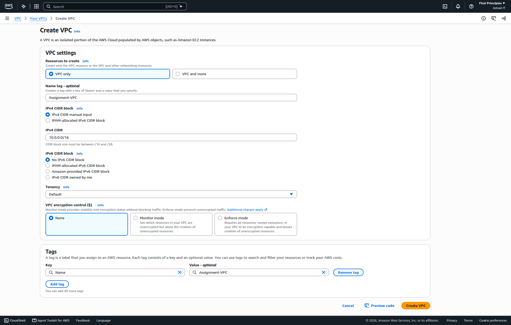
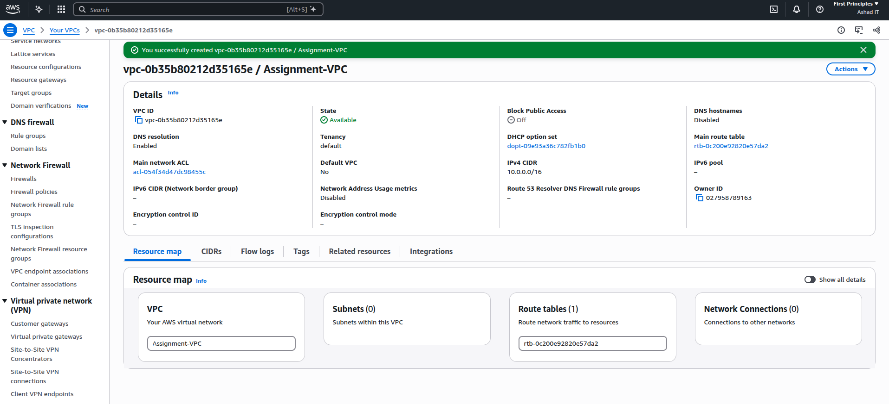
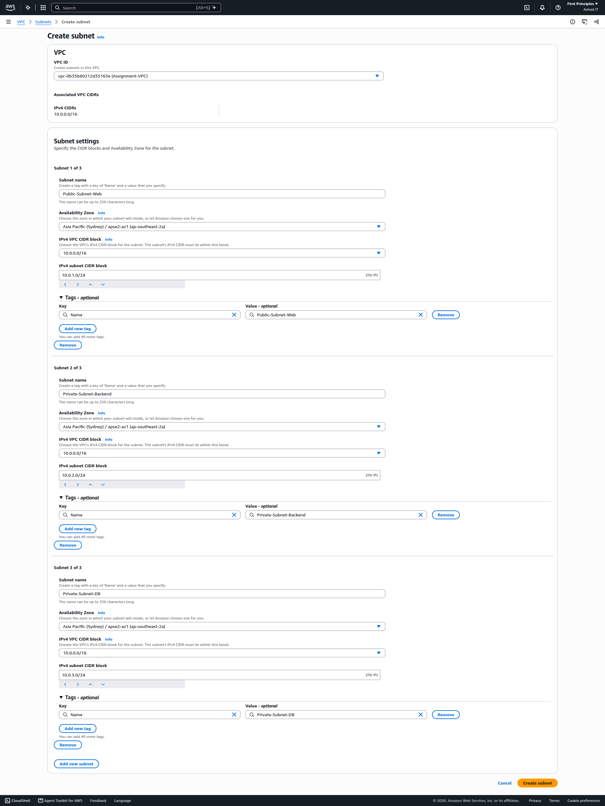
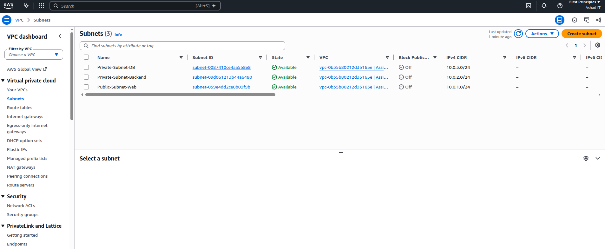

# 3-Tier Application Deployment on Custom AWS VPC (Nginx Only)

## 📌 Project Overview
This project involves deploying a secure **3-Tier Web Application** on Amazon Web Services (AWS) within a custom Virtual Private Cloud (VPC):
- **Web Tier (Public Subnet):** EC2 instance running Nginx acting as the sole public entry point, serving the frontend and reverse-proxying API traffic.
- **Application Tier (Private Subnet):** EC2 instance hosting the backend API service (configured with systemd to auto-restart on reboot).
- **Database Tier (Private Subnet):** EC2 instance running MySQL/PostgreSQL, strictly isolated and accessible only from the Application Tier.

---

## 🚀 Implementation Progress

### Step 1: Create Custom VPC
A custom Virtual Private Cloud (VPC) was provisioned to serve as the isolated networking boundary for the 3-tier architecture.

- **VPC Name:** `Assignment-VPC`
- **IPv4 CIDR Block:** `10.0.0.0/16` (providing 65,536 private IP addresses)
- **Tenancy:** Default
- **VPC ID:** `vpc-0b35b80212d35165e`

#### 1. VPC Configuration
Configuring VPC settings with IPv4 CIDR `10.0.0.0/16` and Name tag `Assignment-VPC`.

#### 2. VPC Successfully Created
The `Assignment-VPC` is provisioned and in an `Available` state with its default route table generated.

---

### Step 2: Subnet Configuration
Three dedicated subnets were created within `Assignment-VPC` across the availability zone (`ap-southeast-2a`) to segregate each tier of the application:

| Subnet Name | Tier / Type | CIDR Block | Availability Zone | Subnet ID | Purpose |
|---|---|---|---|---|---|
| `Public-Subnet-Web` | Web (Public) | `10.0.1.0/24` | `ap-southeast-2a` | `subnet-059e4dd2ce0b03f9b` | Nginx reverse proxy & frontend host |
| `Private-Subnet-Backend` | App (Private) | `10.0.2.0/24` | `ap-southeast-2a` | `subnet-09d061213b44a6480` | Backend API service |
| `Private-Subnet-DB` | Database (Private) | `10.0.3.0/24` | `ap-southeast-2a` | `subnet-0087410ce4aa558e8` | PostgreSQL Database instance |

#### 1. Creating Subnets
Configuring the 3 subnets with their respective CIDR blocks under `Assignment-VPC`.

#### 2. Subnets Created Successfully
All three subnets are successfully created and in the `Available` state.

---

### ⏳ Upcoming Steps (Work in Progress)
- [x] **VPC:** Custom VPC created (`10.0.0.0/16`).
- [x] **Subnets:** Public (Web) and Private (Backend & DB) subnets configured.
- [ ] **Internet & NAT Gateways:** Attach an Internet Gateway for public traffic and provision a NAT Gateway for outbound private traffic.
- [ ] **Route Tables:** Configure separate routing for public and private subnets.
- [ ] **Security Groups:** Enforce tier-to-tier isolation (Internet -> Web SG -> App SG -> DB SG).
- [ ] **EC2 Provisioning & Deployment:**
  - Web Tier: Nginx reverse proxy & frontend
  - App Tier: Backend API service
  - DB Tier: Database setup & persistence
- [ ] **Testing & Verification:** Browser verification of the functional application.
